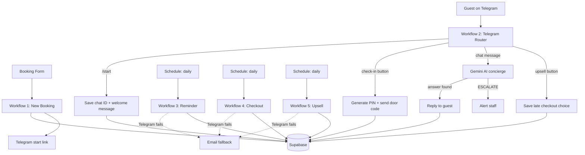

# 🏨 Imagine a Hotel With No Receptionist

**Day 1 of my 30 Days, 30 Workflows challenge.** An automated guest communication and self-check-in system for a 5-room boutique hotel, built with n8n, Supabase, Telegram, and a free AI model, at **$0/month**.

> Every project in this challenge is based on a real job post from Upwork. This one is a personal build modeled on a job post I found, not a paid client project.

---

## The problem

A small hotel wanted to automate most of its front-desk work: check-ins, door codes, guest questions, and in-stay upsells, without a receptionist and with very low software costs.

The goals in the original job post were:

- Automate most front-desk operations (check-in, smart lock PINs, an AI concierge, in-stay upsells)
- Keep recurring software costs under **$40/month**
- Run it solo, with no agencies

## The solution

A digital front desk that never sleeps. Each guest is guided through their whole stay by messages on their phone, and a human is only alerted when the AI can't help.

### The guest journey

| Stage | What happens automatically |
|---|---|
| **Booking** | The guest and booking are saved to the database |
| **Welcome** | The guest taps a link, the bot learns their chat, and a welcome message is sent |
| **Reminder** | The day before arrival, a reminder arrives with an "I'm ready to check in" button |
| **Check-in** | One tap creates a private door code valid only for the stay |
| **AI concierge** | Guests ask questions any time; the AI answers from the hotel's own facts |
| **Escalation** | If the AI doesn't know, or the guest is upset, a staff alert is sent instead of a guess |
| **Upsell** | The day before checkout, the guest is offered a late checkout with Yes/No buttons |
| **Checkout** | A thank-you message goes out and the door code is deactivated |
| **Fallback** | If a Telegram message can't be delivered, the same message is sent by email |

---

## Architecture



## The five workflows

| # | Workflow | Trigger | Job |
|---|---|---|---|
| 1 | `1 - New Booking` | Booking form | Creates the guest and booking, builds the Telegram start link |
| 2 | `2 - Telegram Start` | Telegram messages and button taps | Router: welcome, check-in PIN, AI concierge, escalation, upsell replies |
| 3 | `3 - Reminder` | Schedule (daily) | Sends the pre-arrival reminder with the check-in button |
| 4 | `4 - Checkout` | Schedule (daily) | Sends the checkout message, deactivates the PIN, marks the booking checked out |
| 5 | `5 - Upsell` | Schedule (daily) | Offers a late checkout the day before the guest leaves |

Workflow 2 handles every incoming message and button tap because a Telegram bot can only send its updates to one place. A router (Switch node) sends each update to the right branch: `checkin`, `start`, `chat`, or `upsell`.

---

## Tech stack

| Layer | Tool | Cost |
|---|---|---|
| Automation | n8n | Free (self-hosted) |
| Database | Supabase (Postgres) | Free tier |
| Messaging | Telegram Bot API | Free |
| AI concierge | Google Gemini API (Flash model) | Free tier |
| Email fallback | Gmail node | Free |
| Smart lock | Mock lock service (random PIN stored in the database) | Free |

### Cost

| Item | Monthly cost |
|---|---|
| n8n (self-hosted) | $0 |
| Supabase free tier | $0 |
| Telegram Bot API | $0 |
| Gemini API free tier | $0 |
| Gmail | $0 |
| **Total** | **$0** (target was under $40) |

---

## Database

Five tables: `rooms`, `guests`, `bookings`, `door_codes`, and `messages`.

<details>
<summary>Show the SQL</summary>

```sql
create table rooms (
  id serial primary key,
  room_number text unique not null,
  name text,
  lock_id text
);

create table guests (
  id uuid primary key default gen_random_uuid(),
  full_name text not null,
  email text,
  phone text,
  telegram_chat_id bigint,
  preferred_channel text not null default 'telegram'
    check (preferred_channel in ('telegram','whatsapp','sms','email')),
  created_at timestamptz default now()
);

create table bookings (
  id uuid primary key default gen_random_uuid(),
  guest_id uuid references guests(id) on delete cascade,
  room_id int references rooms(id),
  check_in date not null,
  check_out date not null,
  status text not null default 'confirmed'
    check (status in ('confirmed','checked_in','checked_out','cancelled')),
  welcome_sent boolean default false,
  reminder_sent boolean default false,
  upsell_sent boolean default false,
  late_checkout boolean default false,
  created_at timestamptz default now()
);

create table door_codes (
  id uuid primary key default gen_random_uuid(),
  booking_id uuid references bookings(id) on delete cascade,
  pin text not null,
  valid_from timestamptz not null,
  valid_to timestamptz not null,
  active boolean default true
);

create table messages (
  id uuid primary key default gen_random_uuid(),
  guest_id uuid references guests(id) on delete cascade,
  booking_id uuid references bookings(id) on delete set null,
  direction text not null check (direction in ('inbound','outbound')),
  channel text not null,
  body text not null,
  handled_by text not null default 'system'
    check (handled_by in ('system','ai','human')),
  created_at timestamptz default now()
);

insert into rooms (room_number, name, lock_id) values
  ('101', 'Garden Room', 'lock-101'),
  ('102', 'Courtyard Room', 'lock-102'),
  ('201', 'Terrace Suite', 'lock-201'),
  ('202', 'Skyline Room', 'lock-202'),
  ('203', 'Penthouse Suite', 'lock-203');
```

</details>

### Measuring how much the AI handles

Every message is logged with `handled_by`, so you can measure how much of the conversation needs no human:

```sql
select handled_by, count(*) as messages
from messages
where direction = 'outbound'
group by handled_by;
```

---

## Setup

1. **Supabase:** create a project and run the SQL above.
2. **Telegram:** create a bot with [@BotFather](https://t.me/BotFather) and copy its token.
3. **Gemini:** create a free API key in Google AI Studio.
4. **n8n:** import the five workflow files in this repo (Workflows → Import from file).
5. **Credentials:** create these in n8n: Telegram, Supabase, Google Gemini, Gmail. The exported workflows contain no credentials, so after importing, open each node that shows a red warning and select your own credential.
6. **Settings:**
   - Set each scheduled workflow's timezone to your own.
   - In `Build Start Link`, put your bot's username in the link.
   - In `Alert Staff`, set the chat ID of the person who should receive escalations.
   - Edit the `Hotel Info` node with your hotel's real facts.
7. **Publish** the workflows.

> Credentials and API keys are never included in the exported workflows. Never commit your own keys or tokens to Git.

---

## What I learned

- **Routing is the design:** a single Telegram bot has one trigger, so one router with several branches replaced several separate workflows.
- **Guard against duplicates:** flags like `welcome_sent`, `reminder_sent`, and `upsell_sent` make scheduled workflows safe to run again.
- **A good AI knows when to stop:** the concierge answers only from the hotel's facts and hands over to a human instead of guessing.
- **Fallbacks are part of the product:** every outgoing message has an email backup, so a delivery failure doesn't leave a guest locked out.
- **Hidden spaces break databases:** trimming and validating values saved hours of debugging.

## Limitations

- The smart lock is a **mock**: it generates and stores a PIN but doesn't talk to real hardware.
- It uses **Telegram instead of WhatsApp**, because the WhatsApp Business API needs business verification.
- Upsells are a yes/no offer with no payment step.
- The free Gemini tier may use prompts to improve Google products, so real guest data should go through a paid tier.
- Built for one property.

## Roadmap

- Connect a real smart lock API (for example TTLock or Nuki)
- Add WhatsApp through a provider
- Take payment for upsells
- Add a small dashboard for bookings and message statistics

---

## Screenshots

> Add your images here, for example:
>
> - `docs/architecture.png`: workflow 2 canvas
> - `docs/telegram-chat.png`: welcome, reminder, door code, AI answer
> - `docs/database.png`: Supabase tables

## About

Built by **Azubuko Kiara Uju** as part of the **30 Days, 30 Workflows** challenge. Follow along on TikTok: **[@uju=14]**.

Open to work in AI automation. Reach me at **azubukouju8@gmail.com** or on **[@kiara uju Azubuko]**.
